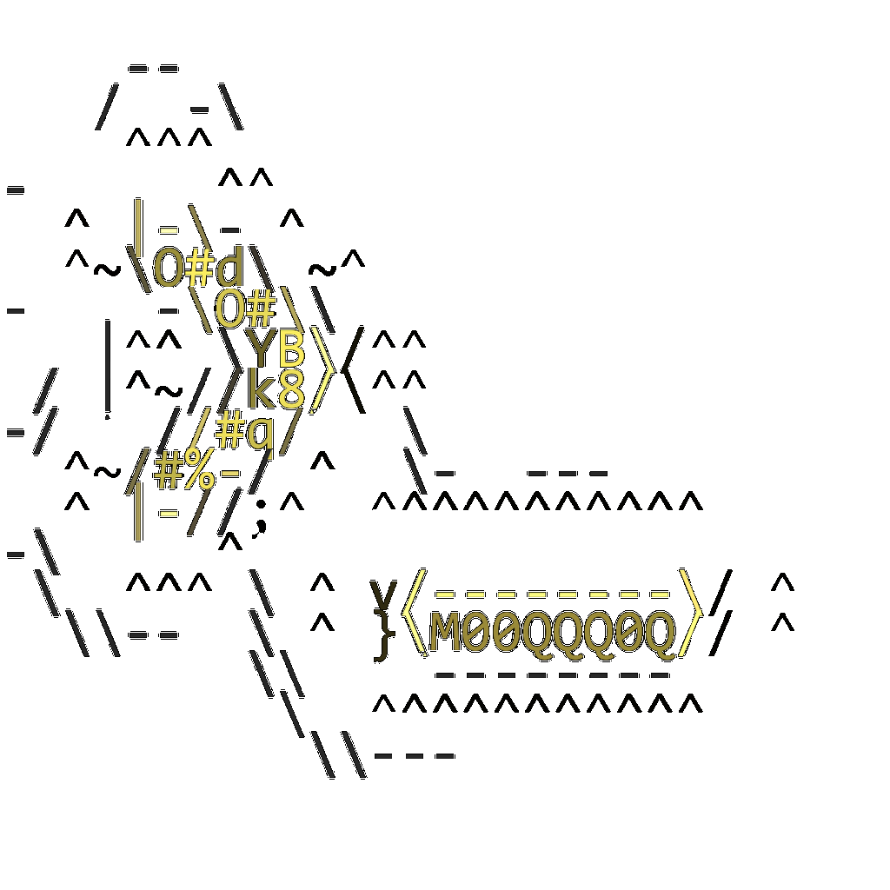
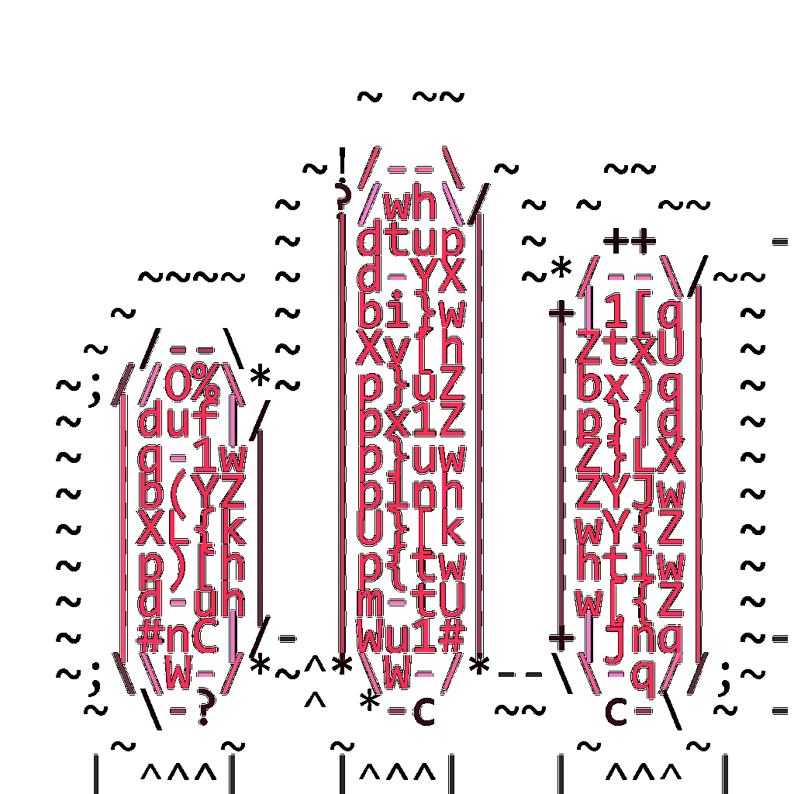

  

<h1 align="center">Mr. Lemon_</h1>

<samp>software with a little zest.</samp>

  Local AI, real-time voice, and projects that started with &quot;how hard can it be?&quot;

  <samp>TypeScript · React · Next.js · Electron · Node.js</samp>

  

## <samp>~/about</samp>

I build tools I want to use myself, usually with Claude Code and Codex open somewhere. A suspicious amount of time goes into how the buttons feel.

I'm into local AI and real-time voice pipelines, especially things that help me focus or make everyday tasks less annoying. I also automate YouTube workflows and tinker with ComfyUI and LM Studio.

## <samp>~/projects</samp>

### [<samp>BadNotes</samp>](https://github.com/Hot-Sweeper/badnotes-desktop)

<strong>OPEN SOURCE / ALPHA</strong> · Windows · Linux · macOS

Basically my open-source, vibecoded take on Goodnotes, aiming for less bloat. It has handwriting, geometry, and a lasso for moving things around; your notebooks stay local. The trash animation may have become a side quest.

[Try the first alpha →](https://github.com/Hot-Sweeper/badnotes-desktop/releases) &nbsp; [Source &amp; docs](https://github.com/Hot-Sweeper/badnotes-desktop#readme)

 

---

### [<samp>Still Browser</samp>](https://github.com/Hot-Sweeper/still-browser)

<strong>EXPERIMENTAL / ALPHA</strong> · No stable release yet.

A Chromium browser with five fixed slots, for anyone whose tab bar is mostly microscopic favicons. Drag to reorder them and pick up the same working set when you come back.

[Try an alpha build →](https://github.com/Hot-Sweeper/still-browser/releases) &nbsp; [Read the docs](https://github.com/Hot-Sweeper/still-browser#readme)

 

---

### [<samp>Peak &amp; Peak Studio</samp>](https://github.com/Hot-Sweeper/peak-and-peak-studio)

<strong>STABLE</strong> · Browser audio studio.

A browser audio studio for making a perfectly good song slower and giving it parking-garage acoustics. Reverb, bass, pitch controls, and WAV export. Your audio stays local.

[Explore the studio →](https://github.com/Hot-Sweeper/peak-and-peak-studio#readme) &nbsp; [Run it locally](https://github.com/Hot-Sweeper/peak-and-peak-studio#run-locally)

 

---

## <samp>~/setup</samp>

- **Current OS:** CachyOS Linux (Arch-based).
- **Coding agents:** Claude Code · Codex.
- **Local AI tools:** ComfyUI · LM Studio.
- **Models I use:** Gemma 4 26B MoE · [Qwen3.8-27B](https://huggingface.co/Qwen/Qwen3.8-27B) · [Qwen3.8-Flash-Next](https://huggingface.co/Qwen/Qwen3.8-Flash-Next).

---

<samp>built by Hot-Sweeper · signed, Mr. Lemon</samp>

